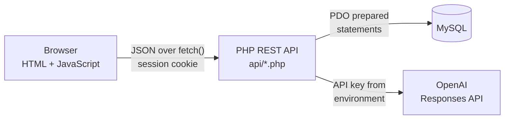
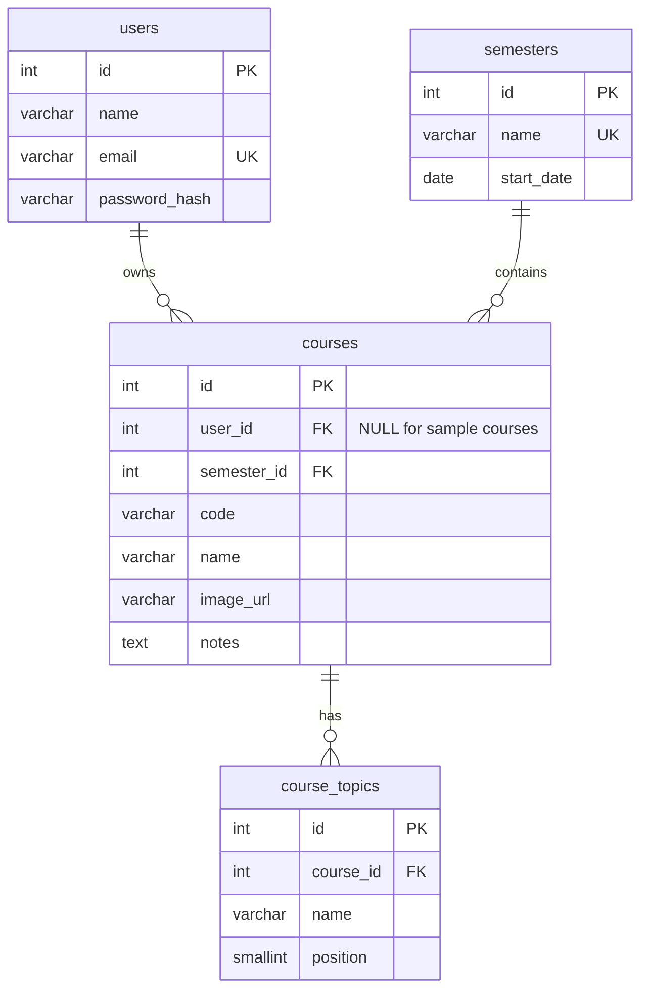

# Podfessor

AI-powered course summaries in the style of a podcast. Add your courses and notes, then ask Podfessor about a topic and it writes a short, friendly lesson script that explains it the way a professor would on a podcast, using your own notes as background.

<!-- Add a screenshot or GIF of the app here, for example:  -->

## Features

- **User accounts**: sign up, log in and log out, with hashed passwords and session cookies.
- **Your own courses**: add, edit and delete courses with topics and notes. Everyone also sees a set of sample courses.
- **Search and filter**: search by course name, code or topic, and filter by semester. Both run as SQL queries on the server.
- **Ask Podfessor**: pick one of your courses, ask a question, and get an AI-written podcast script that uses that course's topics and your notes.
- **Server-side API key**: the browser only talks to this app's PHP API, which calls OpenAI. The key never reaches the client.
- **Tested API**: 39 integration tests cover accounts, permissions, validation, search and the chat endpoint.

## Tech stack

| Layer | Technology |
|---|---|
| Front end | HTML, CSS, JavaScript (Fetch API) |
| Back end | PHP 8 REST API using PDO and cURL |
| Database | MySQL 8 / MariaDB |
| AI | OpenAI Responses API |
| Testing | PHP integration tests against a real test database and a fake OpenAI server |

## How it works



### Database



Courses with no `user_id` are sample courses every visitor can see. A user's own courses are visible only to them. Deleting a user or course cascades to its courses or topics.

### API

All endpoints take and return JSON. Write requests must be sent as `application/json`.

| Method | Endpoint | Description | Login |
|---|---|---|---|
| `POST` | `/api/register.php` | Create an account and log in | |
| `POST` | `/api/login.php` | Log in | |
| `POST` | `/api/logout.php` | Log out | |
| `GET` | `/api/me.php` | The logged-in user, or `null` | |
| `GET` | `/api/semesters.php` | All semesters | |
| `GET` | `/api/courses.php?semester_id=&q=` | Courses you can see, with optional semester filter and search | |
| `GET` | `/api/courses.php?id=1` | One course | |
| `POST` | `/api/courses.php` | Create a course | ✓ |
| `PUT` | `/api/courses.php?id=1` | Update your course | ✓ |
| `DELETE` | `/api/courses.php?id=1` | Delete your course | ✓ |
| `POST` | `/api/chat.php` | `{ prompt, course_id? }` → `{ text }` | ✓ |

Errors return a matching status code (`400`, `401`, `403`, `404`, `409`, `422`) and `{ "error": "message" }`. Validation errors also include `fields`, with one message per field.

### Security

- Passwords are hashed with `password_hash()` (bcrypt) and checked with `password_verify()`.
- Every query uses PDO prepared statements, including the search, which also escapes `%` and `_`.
- Session cookies are `HttpOnly` and `SameSite=Lax`, and the session ID changes at login.
- Write endpoints only accept JSON bodies, which blocks cross-site form submissions.
- Users can only see, change or delete their own courses. Sample courses are read-only.
- The chat requires login, so the OpenAI key can't be used by anonymous visitors.
- All user content is rendered with `textContent`, never as HTML.
- `.env`, the SQL files and the tests are never served to the browser.

## Running it locally

Requirements: PHP 8.1+ with the `pdo_mysql` and `curl` extensions, MySQL 8 or MariaDB 10.6+, and an [OpenAI API key](https://platform.openai.com/api-keys).

1. Clone the repo:

   ```bash
   git clone https://github.com/Ethan-vaz/Podfessor.git
   cd Podfessor
   ```

2. Create a database and user, then load the tables and sample data:

   ```bash
   mysql -u root -p -e "CREATE DATABASE podfessor; CREATE USER 'podfessor'@'localhost' IDENTIFIED BY 'change-me'; GRANT ALL ON podfessor.* TO 'podfessor'@'localhost';"
   mysql -u podfessor -p podfessor < database/schema.sql
   mysql -u podfessor -p podfessor < database/seed.sql
   ```

3. Copy `.env.example` to `.env` and fill in your database password and OpenAI key.

4. Start the server and open http://localhost:8000:

   ```bash
   php -S localhost:8000 router.php
   ```

   `router.php` stops the built-in server from serving private files such as `.env`. On Apache, `.htaccess` does the same job.

## Running the tests

The tests reset a separate `podfessor_test` database, start the app with a fake OpenAI server, and check every endpoint.

```bash
mysql -u root -p -e "CREATE DATABASE podfessor_test; GRANT ALL ON podfessor_test.* TO 'podfessor'@'localhost';"
TEST_DB_USER=podfessor TEST_DB_PASS=change-me tests/run.sh
```

## Project structure

```
├── index.html             Home page: course dashboard and chat
├── newCourse.html         Add or edit a course
├── login.html, signup.html
├── about.html
├── router.php             Blocks private files when using php -S
├── .env.example           Settings template: copy to .env
├── api/
│   ├── _bootstrap.php     Shared config, database connection, sessions, JSON helpers
│   ├── courses.php        Course CRUD, search and filtering
│   ├── semesters.php
│   ├── register.php, login.php, logout.php, me.php
│   └── chat.php           Calls OpenAI with the course's topics and notes
├── database/
│   ├── schema.sql         Tables, keys and indexes
│   └── seed.sql           Semesters and sample courses
├── javascript/
│   ├── common.js          API helper and account menu, used on every page
│   ├── app.js             Course cards, semester filter, search
│   ├── chat.js            Ask Podfessor panel
│   ├── courseForm.js      Add/edit course form
│   └── auth.js            Log in and sign up forms
├── css/styles.css
└── tests/
    ├── run.sh             Sets up the test database and servers, runs the tests
    ├── api_test.php       API integration tests
    └── mock_openai.php    Fake OpenAI server for the tests
```

## Roadmap

- [x] Store courses, notes and users in a MySQL database behind a REST API
- [x] Add and edit courses from the app
- [x] User accounts with secure login
- [ ] Text-to-speech audio for each generated lesson
- [ ] Deploy to the cloud with a live demo link
