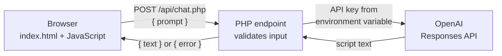

# Podfessor

AI-powered course summaries in the style of a podcast. Browse your courses, then ask Podfessor about a topic and it writes a short, friendly lesson script that explains it the way a professor would on a podcast.

<!-- Add a screenshot or GIF of the app here, for example:  -->

## Features

- **Course dashboard**: course cards with topics, filterable by semester.
- **Live search**: filter courses by name, course code or topic as you type.
- **Ask Podfessor**: send a question and get an AI-written podcast script back, with loading and error states.
- **Server-side API key**: the browser talks only to this app's PHP endpoint, which calls OpenAI. The API key never reaches the client.

## Tech stack

| Layer | Technology |
|---|---|
| Front end | HTML, CSS, JavaScript |
| Back end | PHP 8 (`api/chat.php`) using cURL |
| AI | OpenAI Responses API |

## How it works



The endpoint checks that the request is a `POST`, that the question is not empty and is under 500 characters, and returns a clear error message if anything fails. The full error from OpenAI is written to the server log, not sent to the browser.

## Running it locally

Requirements: PHP 8.0 or newer with the cURL extension, and an [OpenAI API key](https://platform.openai.com/api-keys).

```bash
git clone https://github.com/Ethan-vaz/Podfessor.git
cd Podfessor
OPENAI_API_KEY="your-key-here" php -S localhost:8000
```

Then open http://localhost:8000.

Optional: set `OPENAI_MODEL` to use a different model (the default is `gpt-5`).

## Project structure

```
├── index.html            Home page: course dashboard and chat
├── about.html            About page
├── api/
│   └── chat.php          Server endpoint that calls OpenAI
├── css/
│   └── styles.css
└── javascript/
    ├── app.js            Course cards, semester filter, search
    ├── chat.js           Chat form: sends questions to api/chat.php
    ├── courses.js        Course data
    ├── courseNotes.js    Notes for each course
    └── semesters.js      Semester data
```

## Roadmap

- [ ] Store courses, notes and users in a MySQL database behind a REST API
- [ ] Add and edit courses from the app
- [ ] User accounts with secure login
- [ ] Text-to-speech audio for each generated lesson
- [ ] Deploy to the cloud with a live demo link
